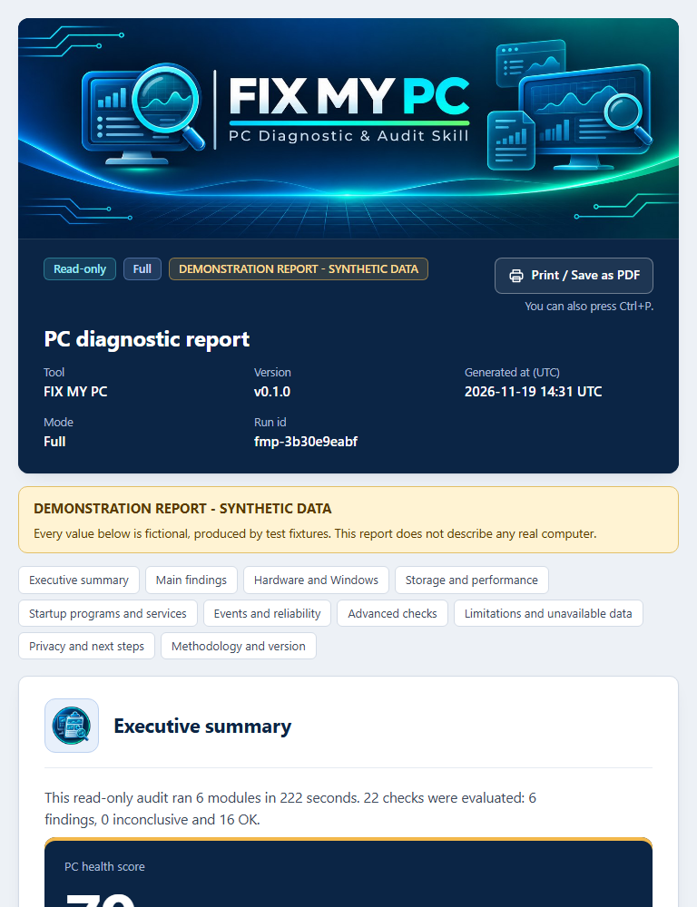

# FIX MY PC

**English** · [Português (Brasil)](README.pt-BR.md)

> **Status**
> - **Source code:** available in this repository under the [MIT License](LICENSE). Copyright (c) 2026 Lucas Sehenth.
> - **FIX MY PC 2.0:** development complete and approved for **supervised personal use, with caveats**.
> - **Packaged release (ZIP):** not released yet. Full-mode validation on physical hardware and release checksums are pending.

FIX MY PC is a read-only diagnostic tool for Windows. It runs real local checks,
applies a deterministic rule set and produces an offline HTML report and a
sanitized JSON file. It never repairs, cleans or changes the computer.

FIX MY PC 2.0 adds advanced Windows diagnostics in **Full mode**. Its
`standard` and `deep` audits were approved with caveats in a supervised
Windows 11 VM. That approval covers supervised personal use only; no packaged
public release exists yet.

## Contents

- [Overview](#overview)
- [Project status](#project-status)
- [Key features](#key-features)
- [How it works](#how-it-works)
- [Diagnostic capabilities](#diagnostic-capabilities)
- [Reports](#reports)
- [Privacy and security](#privacy-and-security)
- [Requirements](#requirements)
- [Getting started](#getting-started)
- [Available modes](#available-modes)
- [Using it as an agent skill](#using-it-as-an-agent-skill)
- [Limitations](#limitations)
- [Development and validation](#development-and-validation)
- [Screenshots](#screenshots)
- [Documentation](#documentation)
- [License](#license)
- [Trademarks and non-affiliation](#trademarks-and-non-affiliation)
- [Disclaimer](#disclaimer)

## Overview

FIX MY PC helps you understand the state of a Windows PC: storage, event logs,
startup items, performance samples and operating-system facts. Each finding
shows its evidence, the documented threshold, its limitations and the human
check that should confirm it.

Most "PC cleaner" tools blur diagnosis with repair. FIX MY PC only diagnoses.
Anything it cannot read is reported as unknown, and unknown data is never turned
into a claim of health or of failure.

It is **not** a health certification, a hardware warranty check, a security
audit or a substitute for professional diagnosis.

## Project status

| Item | State |
|---|---|
| Source code | Published in this repository under the MIT License |
| Development | **FIX MY PC 2.0 complete** (Phases A, B and C), approved for **supervised personal use, with caveats** (tool version 0.2.0-preview) |
| Simple mode | Validated in one supervised run on Windows 11 Enterprise with Windows PowerShell 5.1 |
| Full mode (2.0) | Real `standard` and `deep` audits completed in a supervised Windows 11 VM with standard user permissions. Verdict **approved with caveats**. Physical-hardware validation is pending |
| Windows 10, PowerShell 7 | Not validated and not supported |
| Packaged release (ZIP) | **Not released.** Pending: Full-mode validation on physical hardware and checksums for the release package. The artwork and naming review (`LEGAL-REVIEW`) was closed by the owner on 2026-11-26; it was not a professional legal review |

Current release items are in [`distribution-manifest.json`](distribution-manifest.json)
and [`NOTICE.md`](NOTICE.md). The documents in `docs/reviews/` are dated
records of earlier stages, such as
[`PUBLIC-RELEASE-REMEDIATION-PLAN.md`](docs/reviews/PUBLIC-RELEASE-REMEDIATION-PLAN.md)
(2026-11-21). They document past decisions; they are not current assessments.

## Key features

- **Strictly read-only.** An AST-based static analyzer checks the source against
  command, parameter and member allowlists before the application modules load.
  No repairs, no elevation, no network access.
- **Explicit consent is required for each real run.** The tool shows the
  read-only policy and output folder before asking.
- **Deterministic diagnostic engine with 22 base rules** and symptom-oriented
  Full audits with time-bounded observations and adaptive investigations.
- **Explainable 0–100 score**, with diagnostic **risk**, **coverage** and
  **confidence** reported separately.
- **Seven check states** (`pass`, `finding`, `unknown`, `unsupported`,
  `access_denied`, `not_collected`, `error`). Missing data never improves or
  worsens the score.
- **Self-contained HTML report** in English or Brazilian Portuguese, responsive,
  with a **Print / Save as PDF** button.
- **Sanitized JSON** that masks paths, accounts and similar identifiers.
- **Private output folder**, created by the tool with restricted permissions.

## How it works

```
Consent  →  Read-only collection  →  Deterministic analysis  →  HTML + JSON report
```

1. **Consent.** The tool explains the read-only policy, shows where files will
   be written and asks for your confirmation.
2. **Collection.** The collectors read local Windows information (CIM, event
   logs, registry, scheduled tasks and similar sources). In Full mode, the
   symptom, evidence and approved depth determine which additional passive
   checks run. Nothing is installed, changed or sent anywhere.
3. **Analysis.** The rules in [`rules/rules.json`](rules/rules.json) turn the
   evidence into findings, a score, a risk level, coverage and confidence. There
   is no AI and no network call in this step.
4. **Report.** `report.html` and `diagnostic-sanitized.json` are written to the
   output folder. Nothing is fixed automatically.

## Diagnostic capabilities

| Collector | What it examines |
|---|---|
| System | Operating-system and hardware information, uptime, lifecycle information from a built-in snapshot |
| Events | System and Application logs (Error and Critical, last 7 days): recurring critical events, error concentration, WHEA hardware errors, unexpected shutdowns, bug checks |
| Performance | Short CPU, memory and commit samples. Full mode adds a time-bounded observation of CPU, memory, disks and processes |
| Startup | Run/RunOnce entries, Startup folders, logon scheduled tasks and automatic services, listed but never executed |
| Storage | Free space, disk health as reported by Windows, SMART failure-prediction status, storage error events |
| Advanced (Full mode only) | Devices with problem codes, Windows Defender status, installed apps from passive registry sources, pending-reboot indicators, hotfix recency, Security events when accessible |
| Adaptive investigations (Full mode only) | GPU driver events, GPU engine and VRAM usage, deduplicated Windows Error Reporting, TCP port usage, services within `svchost`, disk-event mapping and storage reliability when triggered, authorized and supported |

The 22 rules, their thresholds and penalties are documented in
[`docs/methodology.md`](docs/methodology.md).

## Reports

- **Offline HTML.** One self-contained file: local CSS, no external resources,
  a restrictive Content-Security-Policy and escaped content. Its only script
  powers the print button and is pinned by SHA-256 in the policy.
- **Score.** 0–100, starting at 100 and reduced only by proven findings, with
  per-category caps. Category weights: Storage 30, Events 25, Performance 20,
  Startup 15, OS 10. Only categories with a penalizing rule and evidence enter
  the score; in version 0.1.0 Startup has no penalizing rule.
- **Risk.** A diagnostic risk level kept apart from the score. A proven critical
  storage failure sets risk to critical and caps the score at 49.
- **Coverage and confidence.** Coverage states how many applicable checks
  completed. Below 60% the score is labelled provisional; below 35% it is
  unavailable. A provisional 100 means "no problem found in the checks that
  completed", never proven health.
- **Limitations.** Every report lists what could not be read and why.
- **Sanitized JSON.** `diagnostic-sanitized.json` follows
  [`schemas/diagnostic.schema.json`](schemas/diagnostic.schema.json).
- **Print / Save as PDF.** Click the button in the report header (or press
  Ctrl+P) to open the browser's own print dialog and choose "Save as PDF". The
  layout is A4 and hides the button when printed. No PDF library is used.

| File | Contents |
|---|---|
| `report.html` | The visual report |
| `diagnostic-sanitized.json` | Redacted diagnostic, evidence, findings and score |
| `diagnostic-internal.json` | Created only with `-IncludeInternalJson`; keep it private |

## Privacy and security

- **Local execution.** The script collects and analyzes on your computer. It has
  no network access by design and does not send reports anywhere.
- **Read-only policy.** Writes are limited to the authorized output folder,
  which contains the reports and, for real runs, `run-reservation.json`.
  See [`docs/readonly-policy.md`](docs/readonly-policy.md)
  for the enforcement layers and their limits.
- **Explicit consent.** Each real run requires confirmation in the terminal
  or explicit approval of the exact command printed by `-Plan`.
  Non-interactive collection requires `-AcceptReadOnlyPolicy` and the
  matching one-use `-ConsentToken`.
- **Restricted output folder.** The tool creates the folder itself with
  permissions limited to your account and SYSTEM and without inheritance from
  the parent. It refuses existing folders, reparse points and network paths, and
  never changes the permissions of existing folders. Local administrators can
  still read files on the computer.
- **Cloud-synced folders.** Before asking for consent the tool warns when the
  folder is on a drive without Windows permissions (FAT/exFAT) or inside
  OneDrive, whose copies can leave the computer. Keep the output outside synced
  folders if that matters to you.
- **Limits of sanitization.** The sanitized JSON masks paths, accounts and
  similar fields, and omits serial numbers, product keys, process arguments and
  raw event messages. It is not anonymization: product, process, provider and
  device names can still identify installed software. Review it before sharing.
- **Skill mode and AI services.** Running the script locally and having an AI
  agent run it are different things. In skill mode the agent reads
  `diagnostic-sanitized.json` and the console output (which includes local
  paths). That content is then processed by the AI service the agent uses,
  under that provider's configuration and terms. Use skill mode only if you are
  comfortable with that, or run the script yourself and share nothing.

## Requirements

Validated environment:

- Windows 11
- Windows PowerShell 5.1 (`powershell.exe`)
- A standard user account. Administrator rights are not needed and should not be
  used.

Windows 10 and PowerShell 7 (`pwsh`) are not validated and not supported.

## Getting started

No packaged public release (ZIP) exists yet. The source code in this
repository can be used from a clone or download, within the status and limits
described in [Project status](#project-status). Put it in a folder you control
and run these commands from that folder in Windows PowerShell 5.1.

Interactive run (explains the policy, then asks language, mode and consent):

```powershell
powershell -NoProfile -File .\fixmypc.ps1
```

For a non-interactive run, generate a plan first. `-OutDir` must be an absolute
local path to a new folder. The tool creates it when the authorized run starts.

```powershell
powershell -NoProfile -NonInteractive -File .\fixmypc.ps1 -Plan `
  -Mode simple -Language en `
  -OutDir "$env:LOCALAPPDATA\FixMyPC\audit-1"
```

Review the policy and scope in the plan. After explicit consent for this run,
execute the exact command printed by `-Plan`, which includes
`-AcceptReadOnlyPolicy` and the matching `-ConsentToken`.

Without `-OutDir`, the report goes to a new folder under `%LOCALAPPDATA%\FixMyPC`.

Other safe commands:

```powershell
# Check the read-only policy of the source itself (no system collection)
powershell -NoProfile -File .\fixmypc.ps1 -ValidateOnly

# Synthetic demo from a fixture (no system access at all)
powershell -NoProfile -File .\fixmypc.ps1 `
  -Fixture .\tests\fixtures\demo-synthetic.json -Mode full -Language en -Yes

# Show usage help
powershell -NoProfile -File .\fixmypc.ps1 -Help
```

The commands respect your effective PowerShell execution policy. If it blocks
the script, use your organization's approved procedure. Do not disable
Windows Defender or lower security settings machine-wide for this tool.

Exit codes: `0` success · `2` read-only policy violation (do not bypass) ·
`3` input or consent error · `4` runtime failure.

To remove FIX MY PC, delete the folder you extracted and, if you no longer need
them, the report folders you created. Nothing else is installed.

## Available modes

| Mode | What runs | Validation |
|---|---|---|
| `simple` (Quick audit) | System, events, startup, a ~4 s performance sample, storage | Validated in one supervised run on Windows 11 Enterprise, standard user, PowerShell 5.1 (before 2.0) |
| `full` (Full audit) | Quick audit plus an observation window of CPU, memory, disks and processes (default 60 s for slowness), Windows boot history, stability events (30 days for crashes), devices, Defender, installed apps, pending-reboot indicators, hotfix recency and Security events when accessible | Approved with caveats after supervised `standard` and `deep` runs in a Windows 11 VM. Physical-hardware validation is pending |

### Symptom-oriented investigation (2.0)

The Full audit asks which problem to investigate (`-Symptom boot|slow|crash|general`). The answer changes the
observation window, the event history read and how results are ranked. A deterministic layer
(`src/analysis/Diagnosis.ps1`) answers fixed questions - did the CPU stay saturated, was memory under pressure with
paging, was a disk busy or slow to respond, did Windows record degraded boots, are unexpected restarts recurring - and
records for each answer the evidence values, source, window, relevance to the symptom, confidence, limitations and
alternative explanations. It never asserts a cause and never turns missing data into "healthy". The report opens with
the result in plain language (up to three key findings, each with *what we observed*, *why it matters* and *what you
can do*); the 0-100 score moves after it as a secondary figure. See [`docs/methodology.md`](docs/methodology.md).

**Phase A** distinguishes Private Bytes (private committed memory), Working Set and private Working Set. It
measures recent I/O per process, groups usage by executable and reads a fixed catalog of System events by provider
and ID. The incident timeline can use `-IncidentAt` and `-IncidentToleranceMinutes` to flag nearby evidence for review.

**Phase B** adds GPU driver event, engine and VRAM analysis, deduplicates Windows Error Reporting events,
counts TCP connections by state and process against the dynamic port range, lists services in selected `svchost`
processes and maps recent storage events to current disks where possible. Network checks use local sources and
omit connection addresses and port numbers.

**Phase C** selects complementary checks from a fixed catalog using the symptom and initial evidence. Each depth
has a time budget and stop criteria. `standard` is the default. With consent for `-Depth deep`, the audit can read
more event history and, when triggered, check storage reliability or take a second sample to confirm a peak.
The report records which hypotheses the evidence supports and which checks were inconclusive or unavailable.

Observation uses raw CIM performance classes (locale independent) and computes rates from deltas; it never writes,
benchmarks or stresses the disk. The Windows boot performance log usually needs administrator rights: without them the
report says "not verified" and the tool does not elevate.

## Using it as an agent skill

[`SKILL.md`](SKILL.md) turns this repository into an
[Agent Skills](https://agentskills.io) skill (Claude Code and Codex-compatible
adapters: [`adapters/claude/README.md`](adapters/claude/README.md),
[`adapters/codex/AGENTS.md`](adapters/codex/AGENTS.md)). The agent contract
forbids changing the computer, inventing collection commands or bypassing
consent.

Invocation: `/fixmypc audit` in Claude Code, `$fixmypc` (plus `audit` or a
description) in Codex. The agent welcomes the person, offers the Quick or Full
audit, asks the symptom, then runs `fixmypc.ps1 -Plan ...`, which collects
nothing and prints the authorization request: mode, language, goal, data read,
duration estimate, output folder, AI processing, "no repairs" and the exact
command with a one-run `-ConsentToken`. The person answers once, in the chat;
the agent then runs exactly that command.

**`-AcceptReadOnlyPolicy` does not prove that a human authorized the run.** An
agent can add it without asking. Non-interactive real runs require the
`-ConsentToken` printed by `-Plan` for that exact run. The token
binds the scope, including mode, symptom, language, observation window, incident
settings, depth and output folder, for 30 minutes. An exclusive
`run-reservation.json` consumes the authorization before collection and blocks
repeat or concurrent use.
Consent must be requested from the person for every real run, never reused,
and never stored in a script, hook or standing permission.

*Migration:* agent instructions written for 0.1.0 (`-AcceptReadOnlyPolicy`
alone) now end with exit code 3. Use `-Plan`, show its output, and run the
printed command after an explicit answer. Interactive terminal runs and fixture
runs are unchanged. See
[Privacy and security](#privacy-and-security) for what the agent's AI service
receives.

## Limitations

- **SMART may be unavailable.** It can need permissions or driver support that a
  standard user lacks. Unavailable SMART means "unknown", not "healthy".
- **Some collectors need permissions a standard user does not have** (for
  example the Security log). They are reported as `access_denied` and lower
  coverage and confidence; they do not lower the score.
- **Windows queries can be slow or block.** Event log and scheduled-task queries
  have no built-in timeout. If a run hangs, press Ctrl+C; results are only
  written in the final report phase (a real run leaves just its
  `run-reservation.json`, and its authorization is used up).
- **A clean report is not a guarantee.** Rules are conservative and sample a
  point in time; absence of findings does not prove absence of problems.
- **Limited compatibility.** Only the environment under
  [Requirements](#requirements) has been exercised. Full mode has only been exercised in a supervised VM.
  GPU and VRAM counters, real TCP port exhaustion and administrator-only paths
  remain unverified. Incident-time correlation was covered only with synthetic data.
- **Smaller known gaps:** shortcut (`.lnk`) startup targets are not resolved;
  Authenticode verification is not collected; Windows lifecycle dates come from
  a built-in snapshot that can become outdated; pending Windows Update scans are
  deliberately not run.
- **Threshold calibration is pending.** VM measurements come from virtual
  hardware. The diagnostic thresholds are initial review points.

## Development and validation

**2.0 (previously recorded):** the consolidated regression of Phases A, B and C recorded **1,481 synthetic assertions and no failures**.
The `svchost` service-name fix added two regression assertions (`PhaseBC.Tests.ps1`, 213 assertions, no failures).
Supervised `standard` and `deep` audits in a Windows 11 VM were **approved with caveats for personal use**, with mandatory
per-run consent and the read-only policy preserved. Pending validation includes dedicated-GPU providers and counters
(NVIDIA, AMD, Intel), an administrator run, `-IncidentAt` correlation with real events, TCP port exhaustion, measurement
of the tool's CPU and memory cost, threshold calibration and confirmation of service names in a real report after the fix.

Earlier recorded results (Stage 11, before 2.0, synthetic and offline):

| Suite | Result |
|---|---|
| `tests/Run.Tests.ps1` | 453 / 453 |
| `tests/Collector.Tests.ps1` | 85 / 85 |
| `tests/Visual.Tests.ps1` | 307 / 307 |
| `-ValidateOnly` | pass |
| Distribution manifest check | pass |

These suites use synthetic fixtures and isolated mocks to verify the code and
the report. Physical-hardware evidence so far comes from one supervised Simple
mode run on Windows 11 Enterprise. Full mode has separate VM evidence.
Validation of Full mode on physical hardware, other Windows editions and
versions, and corporate policies (AppLocker, WDAC, Constrained Language Mode)
is still pending. See [`docs/homologation-plan.md`](docs/homologation-plan.md).

```powershell
powershell -NoProfile -File .\tests\Run.Tests.ps1
powershell -NoProfile -File .\tests\Collector.Tests.ps1
powershell -NoProfile -File .\tests\Visual.Tests.ps1
powershell -NoProfile -File .\tools\Test-DistributionManifest.ps1
```

## Screenshots

Both images show a **synthetic demonstration report**: every value is fictional
and no real computer is described.




More synthetic examples are in [`samples/`](samples/).

## Documentation

The technical documents in `docs/` are currently written in Portuguese (Brazil).

- [`docs/readonly-policy.md`](docs/readonly-policy.md): the read-only policy,
  enforcement layers and honest limits.
- [`docs/methodology.md`](docs/methodology.md): check states, severities, scoring,
  coverage, confidence and the 22 rules.
- [`docs/visual-integration.md`](docs/visual-integration.md): report visual
  identity and assets.
- [`docs/homologation-plan.md`](docs/homologation-plan.md): planned validation.
- [`CHANGELOG.md`](CHANGELOG.md) and [`NOTICE.md`](NOTICE.md).

## License

FIX MY PC is licensed under the [MIT License](LICENSE) (SPDX: `MIT`).
Copyright (c) 2026 Lucas Sehenth. The license text in [`LICENSE`](LICENSE) is
the only binding statement.

The v2 artwork was generated with ChatGPT for this project. It is released
under the same MIT License, to the extent of the rights the holder has; images
made by AI may carry no copyright at all, so no exclusive rights are claimed.
The MIT License grants no trademark rights: the FIX MY PC name is not licensed.
See [`NOTICE.md`](NOTICE.md) and
[`docs/artwork-provenance.md`](docs/artwork-provenance.md).

## Trademarks and non-affiliation

FIX MY PC is an independent project. It is **not affiliated with, endorsed by,
sponsored by or approved by Microsoft**. Windows is a trademark of Microsoft
Corporation, named here only to state compatibility. See [`NOTICE.md`](NOTICE.md).

## Disclaimer

FIX MY PC reports information; it does not repair, clean or reconfigure
anything. Results need proper interpretation: use the recommended human check
listed with each finding and consult a qualified technician for decisions about
your hardware, data or security. The score is a review aid, not a hardware
diagnosis, a warranty or a security certification. The software is provided
under the terms of the MIT License, "as is" and without warranty.
