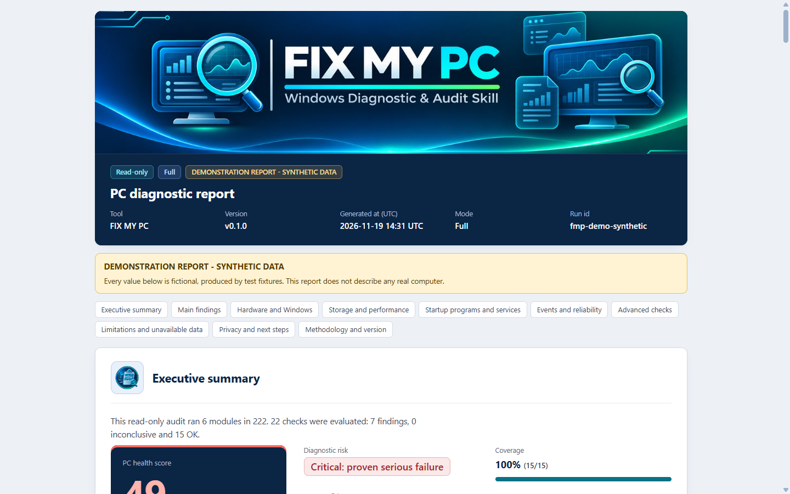
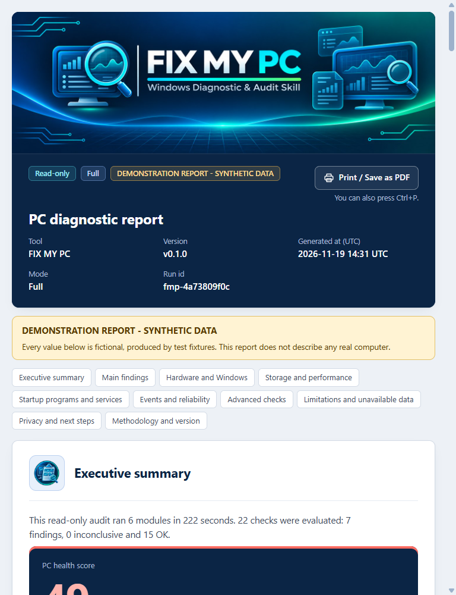

# FIX MY PC

**English** · [Português (Brasil)](README.pt-BR.md)

> **Status: Still in Development — Functional Preview.**
> Free for noncommercial use under the [PolyForm Noncommercial License 1.0.0](LICENSE).
> Source-available, not OSI-approved open source. No public release has been approved yet.

FIX MY PC is a read-only diagnostic tool for Windows. It runs real local checks,
applies a deterministic rule set and produces an offline HTML report and a
sanitized JSON file. It never repairs, cleans or changes the computer.

The tool already works for supervised personal use in **Simple mode**. It is
still in development, in compatibility validation and in release preparation,
so treat every result as a review aid and expect rough edges.

## Contents

- [Overview](#overview)
- [Project status](#project-status)
- [Key features](#key-features)
- [How it works](#how-it-works)
- [Diagnostic capabilities](#diagnostic-capabilities)
- [Reports](#reports)
- [Privacy and security](#privacy-and-security)
- [Requirements](#requirements)
- [Getting started](#getting-started)
- [Available modes](#available-modes)
- [Using it as an agent skill](#using-it-as-an-agent-skill)
- [Limitations](#limitations)
- [Development and validation](#development-and-validation)
- [Screenshots](#screenshots)
- [Documentation](#documentation)
- [License](#license)
- [Trademarks and non-affiliation](#trademarks-and-non-affiliation)
- [Disclaimer](#disclaimer)

## Overview

FIX MY PC helps you understand the state of a Windows PC: storage, event logs,
startup items, performance samples and operating-system facts. Each finding
shows its evidence, the documented threshold, its limitations and the human
check that should confirm it.

Most "PC cleaner" tools blur diagnosis with repair. FIX MY PC only diagnoses.
Anything it cannot read is reported as unknown, and unknown data is never turned
into a claim of health or of failure.

It is **not** a health certification, a hardware warranty check, a security
audit or a substitute for professional diagnosis.

## Project status

| Item | State |
|---|---|
| Release stage | **Still in Development — Functional Preview** (version 0.1.0) |
| Simple mode | Validated in one supervised run on Windows 11 Enterprise with Windows PowerShell 5.1 |
| Full mode | Implemented and covered by synthetic tests. **Not yet validated on real hardware** |
| Windows 10, PowerShell 7 | Not validated and not supported |
| Public release | **Not approved.** Open items: legal review, hardware and virtual-machine validation, published checksums |

Open release items are tracked in
[`distribution-manifest.json`](distribution-manifest.json),
[`docs/reviews/PUBLIC-RELEASE-REMEDIATION-PLAN.md`](docs/reviews/PUBLIC-RELEASE-REMEDIATION-PLAN.md)
and [`NOTICE.md`](NOTICE.md).

## Key features

- **Strictly read-only.** An AST-based static analyzer checks the source against
  command, parameter and member allowlists before the application modules load.
  No repairs, no elevation, no network access.
- **Explicit consent before any collection**, with the output folder and policy
  shown first.
- **Six collectors** (system, events, startup, performance, storage, advanced)
  and a **deterministic engine of 22 rules**.
- **Explainable 0–100 score**, with diagnostic **risk**, **coverage** and
  **confidence** reported separately.
- **Seven check states** (`pass`, `finding`, `unknown`, `unsupported`,
  `access_denied`, `not_collected`, `error`). Missing data never improves or
  worsens the score.
- **Self-contained HTML report** in English or Brazilian Portuguese, responsive,
  with a **Print / Save as PDF** button.
- **Sanitized JSON** that masks paths, accounts and similar identifiers.
- **Private output folder**, created by the tool with restricted permissions.

## How it works

```
Consent  →  Read-only collection  →  Deterministic analysis  →  HTML + JSON report
```

1. **Consent.** The tool explains the read-only policy, shows where files will
   be written and asks for your confirmation.
2. **Collection.** The collectors read local Windows information (CIM, event
   logs, registry, scheduled tasks and similar sources). Nothing is installed,
   changed or sent anywhere.
3. **Analysis.** The rules in [`rules/rules.json`](rules/rules.json) turn the
   evidence into findings, a score, a risk level, coverage and confidence. There
   is no AI and no network call in this step.
4. **Report.** `report.html` and `diagnostic-sanitized.json` are written to the
   output folder. Nothing is fixed automatically.

## Diagnostic capabilities

| Collector | What it examines |
|---|---|
| System | Operating-system and hardware information, uptime, lifecycle information from a built-in snapshot |
| Events | System and Application logs (Error and Critical, last 7 days): recurring critical events, error concentration, WHEA hardware errors, unexpected shutdowns, bug checks |
| Performance | Short CPU, memory and commit samples, taken once during the run |
| Startup | Run/RunOnce entries, Startup folders, logon scheduled tasks and automatic services, listed but never executed |
| Storage | Free space, disk health as reported by Windows, SMART failure-prediction status, storage error events |
| Advanced (Full mode only) | Devices with problem codes, Windows Defender status, installed apps from passive registry sources, pending-reboot indicators, hotfix recency, Security events when accessible |

The 22 rules, their thresholds and penalties are documented in
[`docs/methodology.md`](docs/methodology.md).

## Reports

- **Offline HTML.** One self-contained file: local CSS, no external resources,
  a restrictive Content-Security-Policy and escaped content. Its only script
  powers the print button and is pinned by SHA-256 in the policy.
- **Score.** 0–100, starting at 100 and reduced only by proven findings, with
  per-category caps. Category weights: Storage 30, Events 25, Performance 20,
  Startup 15, OS 10. Only categories with a penalizing rule and evidence enter
  the score; in version 0.1.0 Startup has no penalizing rule.
- **Risk.** A diagnostic risk level kept apart from the score. A proven critical
  storage failure sets risk to critical and caps the score at 49.
- **Coverage and confidence.** Coverage states how many applicable checks
  completed. Below 60% the score is labelled provisional; below 35% it is
  unavailable. A provisional 100 means "no problem found in the checks that
  completed", never proven health.
- **Limitations.** Every report lists what could not be read and why.
- **Sanitized JSON.** `diagnostic-sanitized.json` follows
  [`schemas/diagnostic.schema.json`](schemas/diagnostic.schema.json).
- **Print / Save as PDF.** Click the button in the report header (or press
  Ctrl+P) to open the browser's own print dialog and choose "Save as PDF". The
  layout is A4 and hides the button when printed. No PDF library is used.

| File | Contents |
|---|---|
| `report.html` | The visual report |
| `diagnostic-sanitized.json` | Redacted diagnostic, evidence, findings and score |
| `diagnostic-internal.json` | Created only with `-IncludeInternalJson`; keep it private |

## Privacy and security

- **Local execution.** The script collects and analyzes on your computer. It has
  no network access by design and does not send reports anywhere.
- **Read-only policy.** The only writes are the report files inside the output
  folder you authorize. See [`docs/readonly-policy.md`](docs/readonly-policy.md)
  for the enforcement layers and their honest limits.
- **Explicit consent.** Collection does not start without it. The
  `-AcceptReadOnlyPolicy` flag is a declaration by whoever writes the command
  line; it does not prove a human agreed.
- **Restricted output folder.** The tool creates the folder itself with
  permissions limited to your account and SYSTEM and without inheritance from
  the parent. It refuses existing folders, reparse points and network paths, and
  never changes the permissions of existing folders. Local administrators can
  still read files on the computer.
- **Cloud-synced folders.** Before asking for consent the tool warns when the
  folder is on a drive without Windows permissions (FAT/exFAT) or inside
  OneDrive, whose copies can leave the computer. Keep the output outside synced
  folders if that matters to you.
- **Limits of sanitization.** The sanitized JSON masks paths, accounts and
  similar fields, and omits serial numbers, product keys, process arguments and
  raw event messages. It is not anonymization: product, process, provider and
  device names can still identify installed software. Review it before sharing.
- **Skill mode and AI services.** Running the script locally and having an AI
  agent run it are different things. In skill mode the agent reads
  `diagnostic-sanitized.json` and the console output (which includes local
  paths). That content is then processed by the AI service the agent uses,
  under that provider's configuration and terms. Use skill mode only if you are
  comfortable with that, or run the script yourself and share nothing.

## Requirements

Validated environment:

- Windows 11
- Windows PowerShell 5.1 (`powershell.exe`)
- A standard user account. Administrator rights are not needed and should not be
  used.

Windows 10 and PowerShell 7 (`pwsh`) are not validated and not supported.

## Getting started

There is no public release or download yet. If you received a copy from the
project owner, extract it to a folder you control and run these commands from
that folder in Windows PowerShell 5.1.

Interactive run (explains the policy, then asks language, mode and consent):

```powershell
powershell -NoProfile -File .\fixmypc.ps1
```

Non-interactive run. `-OutDir` must be an absolute local path that **does not
exist yet**; the tool creates it. Add `-AcceptReadOnlyPolicy` only if you
yourself confirm the read-only policy for this run:

```powershell
powershell -NoProfile -File .\fixmypc.ps1 `
  -Mode simple -Language en `
  -OutDir "$env:LOCALAPPDATA\FixMyPC\audit-1" -AcceptReadOnlyPolicy
```

Without `-OutDir`, the report goes to a new folder under `%LOCALAPPDATA%\FixMyPC`.

Other safe commands:

```powershell
# Check the read-only policy of the source itself (no system collection)
powershell -NoProfile -File .\fixmypc.ps1 -ValidateOnly

# Synthetic demo from a fixture (no system access at all)
powershell -NoProfile -File .\fixmypc.ps1 `
  -Fixture .\tests\fixtures\demo-synthetic.json -Mode full -Language en -Yes

# Show usage help
powershell -NoProfile -File .\fixmypc.ps1 -Help
```

The commands respect your effective PowerShell execution policy. If it blocks
the script, use your organization's approved procedure. Do not disable
Windows Defender or lower security settings machine-wide for this tool.

Exit codes: `0` success · `2` read-only policy violation (do not bypass) ·
`3` input or consent error · `4` runtime failure.

To remove FIX MY PC, delete the folder you extracted and, if you no longer need
them, the report folders you created. Nothing else is installed.

## Available modes

| Mode | What runs | Validation |
|---|---|---|
| `simple` | System, events, startup, performance, storage | Validated in one supervised run on Windows 11 Enterprise, standard user, PowerShell 5.1 |
| `full` | Simple mode plus devices, Defender, installed apps, pending-reboot indicators, hotfix recency and Security events when accessible | Implemented and tested with synthetic data only. Not validated on real hardware |

"Implemented" means the code exists and passes synthetic tests. "Validated"
means it was run on a real machine under supervision.

## Using it as an agent skill

[`SKILL.md`](SKILL.md) turns this repository into an
[Agent Skills](https://agentskills.io) skill (Claude Code and Codex-compatible
adapters: [`adapters/claude/README.md`](adapters/claude/README.md),
[`adapters/codex/AGENTS.md`](adapters/codex/AGENTS.md)). The agent contract
forbids changing the computer, inventing collection commands or bypassing
consent.

**`-AcceptReadOnlyPolicy` does not prove that a human authorized the run.** An
agent can add it without asking. Consent must be requested from the person for
every real run (exact command, mode, language and output folder), never reused,
and never stored in a script, hook or standing permission. See
[Privacy and security](#privacy-and-security) for what the agent's AI service
receives.

## Limitations

- **SMART may be unavailable.** It can need permissions or driver support that a
  standard user lacks. Unavailable SMART means "unknown", not "healthy".
- **Some collectors need permissions a standard user does not have** (for
  example the Security log). They are reported as `access_denied` and lower
  coverage and confidence; they do not lower the score.
- **Windows queries can be slow or block.** Event log and scheduled-task queries
  have no built-in timeout. If a run hangs, press Ctrl+C; nothing is written
  before the final report phase.
- **A clean report is not a guarantee.** Rules are conservative and sample a
  point in time; absence of findings does not prove absence of problems.
- **Limited compatibility.** Only the environment under
  [Requirements](#requirements) has been exercised, and only Simple mode on real
  hardware.
- **Smaller known gaps:** shortcut (`.lnk`) startup targets are not resolved;
  Authenticode verification is not collected; Windows lifecycle dates come from
  a built-in snapshot that can become outdated; pending Windows Update scans are
  deliberately not run.
- **Still in development.** Interfaces, rules and report layout may change.

## Development and validation

Last recorded results (Stage 11, synthetic and offline):

| Suite | Result |
|---|---|
| `tests/Run.Tests.ps1` | 453 / 453 |
| `tests/Collector.Tests.ps1` | 85 / 85 |
| `tests/Visual.Tests.ps1` | 307 / 307 |
| `-ValidateOnly` | pass |
| Distribution manifest check | pass |

These suites use synthetic fixtures and isolated mocks. They verify the code and
the report, **not** behavior on real hardware, and are not a hardware
homologation. The only real-hardware evidence so far is one supervised Simple
mode run on a single Windows 11 Enterprise machine. Full mode, other Windows
editions and versions, virtual-machine homologation and corporate policies
(AppLocker, WDAC, Constrained Language Mode) are still pending; see
[`docs/homologation-plan.md`](docs/homologation-plan.md).

```powershell
powershell -NoProfile -File .\tests\Run.Tests.ps1
powershell -NoProfile -File .\tests\Collector.Tests.ps1
powershell -NoProfile -File .\tests\Visual.Tests.ps1
powershell -NoProfile -File .\tools\Test-DistributionManifest.ps1
```

## Screenshots

Both images show a **synthetic demonstration report**: every value is fictional
and no real computer is described.





More synthetic examples are in [`samples/`](samples/).

## Documentation

The technical documents in `docs/` are currently written in Portuguese (Brazil).

- [`docs/readonly-policy.md`](docs/readonly-policy.md): the read-only policy,
  enforcement layers and honest limits.
- [`docs/methodology.md`](docs/methodology.md): check states, severities, scoring,
  coverage, confidence and the 22 rules.
- [`docs/visual-integration.md`](docs/visual-integration.md): report visual
  identity and assets.
- [`docs/homologation-plan.md`](docs/homologation-plan.md): planned validation.
- [`CHANGELOG.md`](CHANGELOG.md) and [`NOTICE.md`](NOTICE.md).

## License

FIX MY PC is licensed under the
[PolyForm Noncommercial License 1.0.0](LICENSE). In short: you may use, study,
modify and redistribute it for noncommercial purposes at no cost. Commercial use
is not granted and needs separate written permission from the project owner. The
license text in [`LICENSE`](LICENSE) is the only binding statement.

This is a source-available license; it is **not** an OSI-approved open source
license.

The license covers the software. The FIX MY PC name, logo and v2 artwork are
handled separately: their ownership is not yet recorded and the product name is
awaiting legal review. See [`NOTICE.md`](NOTICE.md). A public release stays
blocked until those items are resolved.

## Trademarks and non-affiliation

FIX MY PC is an independent project. It is **not affiliated with, endorsed by,
sponsored by or approved by Microsoft**. Windows is a trademark of Microsoft
Corporation, named here only to state compatibility. See [`NOTICE.md`](NOTICE.md).

## Disclaimer

FIX MY PC reports information; it does not repair, clean or reconfigure
anything. Results need proper interpretation: use the recommended human check
listed with each finding and consult a qualified technician for decisions about
your hardware, data or security. The score is a review aid, not a hardware
diagnosis, a warranty or a security certification. The software is provided
under the terms of the license, including its "No Liability" clause.
