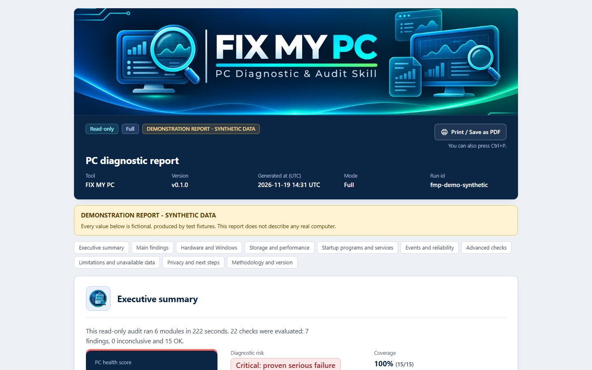

# FIX MY PC

[English](README.md) · **Português (Brasil)**

> **Status**
> - **Código-fonte:** disponível neste repositório sob a [Licença MIT](LICENSE). Copyright (c) 2026 Lucas Sehenth.
> - **FIX MY PC 2.0:** desenvolvimento concluído e aprovado para **uso pessoal supervisionado, com ressalvas**.
> - **Pacote de lançamento (ZIP):** ainda não lançado. Estão pendentes a validação do Modo Completo em hardware físico e os checksums do pacote.

O FIX MY PC é uma ferramenta de diagnóstico para Windows, somente leitura. Ela
executa verificações locais reais, aplica um conjunto determinístico de regras e
gera um relatório HTML offline e um arquivo JSON sanitizado. Nunca repara, limpa
nem altera o computador.

O FIX MY PC 2.0 acrescenta diagnóstico avançado do Windows no **Modo Completo**.
As auditorias `standard` e `deep` foram aprovadas com ressalvas em uma VM
Windows 11 supervisionada. Essa aprovação vale só para uso pessoal supervisionado;
ainda não existe pacote público de lançamento.

## Conteúdo

- [Visão geral](#visão-geral)
- [Status do projeto](#status-do-projeto)
- [Principais recursos](#principais-recursos)
- [Como funciona](#como-funciona)
- [Capacidades de diagnóstico](#capacidades-de-diagnóstico)
- [Relatórios](#relatórios)
- [Privacidade e segurança](#privacidade-e-segurança)
- [Requisitos](#requisitos)
- [Primeiros passos](#primeiros-passos)
- [Modos disponíveis](#modos-disponíveis)
- [Uso como skill de agente](#uso-como-skill-de-agente)
- [Limitações](#limitações)
- [Desenvolvimento e validação](#desenvolvimento-e-validação)
- [Capturas de tela](#capturas-de-tela)
- [Documentação](#documentação)
- [Licença](#licença)
- [Marcas e não afiliação](#marcas-e-não-afiliação)
- [Aviso legal](#aviso-legal)

## Visão geral

O FIX MY PC ajuda a entender o estado de um PC com Windows: armazenamento, logs
de eventos, itens de inicialização, amostras de desempenho e informações do
sistema operacional. Cada achado mostra a evidência, o limiar documentado, suas
limitações e a verificação humana que deve confirmá-lo.

A maioria dos "limpadores de PC" mistura diagnóstico com reparo. O FIX MY PC só
diagnostica. O que não puder ser lido é informado como desconhecido, e dado
desconhecido nunca vira afirmação de saúde nem de falha.

Ele **não** é certificação de saúde, verificação de garantia de hardware,
auditoria de segurança nem substituto de um diagnóstico profissional.

## Status do projeto

| Item | Situação |
|---|---|
| Código-fonte | Publicado neste repositório sob a Licença MIT |
| Desenvolvimento | **FIX MY PC 2.0 concluído** (Fases A, B e C), aprovado para **uso pessoal supervisionado, com ressalvas** (versão da ferramenta 0.1.0) |
| Modo Simples | Validado em uma execução supervisionada no Windows 11 Enterprise com Windows PowerShell 5.1 |
| Modo Completo (2.0) | Auditorias reais `standard` e `deep` concluídas em VM Windows 11 supervisionada com permissões de usuário comum. Veredito **aprovado com ressalvas**. A validação em hardware físico está pendente |
| Windows 10, PowerShell 7 | Não validados e não suportados |
| Pacote de lançamento (ZIP) | **Não lançado.** Pendentes: validação do Modo Completo em hardware físico e checksums do pacote. A revisão de artes e nome (`LEGAL-REVIEW`) foi encerrada pelo proprietário em 26/11/2026; não foi uma revisão jurídica profissional |

As pendências atuais de lançamento estão em
[`distribution-manifest.json`](distribution-manifest.json) e [`NOTICE.md`](NOTICE.md).
Os documentos em `docs/reviews/` são registros datados de etapas anteriores, como
[`PUBLIC-RELEASE-REMEDIATION-PLAN.md`](docs/reviews/PUBLIC-RELEASE-REMEDIATION-PLAN.md)
(21/11/2026). Eles documentam decisões passadas; não são avaliações atuais.

## Principais recursos

- **Estritamente somente leitura.** Um analisador estático baseado em AST confere
  o código-fonte contra listas permitidas de comandos, parâmetros e membros antes
  de carregar os módulos da aplicação. Sem reparos, sem elevação, sem acesso à
  rede.
- **Consentimento explícito obrigatório a cada execução real.** A ferramenta
  exibe a política somente leitura e a pasta de saída antes de pedir confirmação.
- **Motor de diagnóstico determinístico com 22 regras de base** e auditoria
  completa por sintoma, com janelas de observação e investigação adaptativa.
- **Pontuação de 0 a 100 explicável**, com **risco** diagnóstico, **cobertura** e
  **confiança** informados separadamente.
- **Sete estados de verificação** (`pass`, `finding`, `unknown`, `unsupported`,
  `access_denied`, `not_collected`, `error`). Dado ausente nunca melhora nem piora
  a pontuação.
- **Relatório HTML autocontido** em português do Brasil ou inglês, responsivo,
  com botão **Imprimir / Salvar em PDF**.
- **JSON sanitizado**, que mascara caminhos, contas e identificadores
  semelhantes.
- **Pasta de saída privada**, criada pela própria ferramenta com permissões
  restritas.

## Como funciona

```
Consentimento  →  Coleta somente leitura  →  Análise determinística  →  Relatório HTML + JSON
```

1. **Consentimento.** A ferramenta explica a política de somente leitura, mostra
   onde os arquivos serão gravados e pede sua confirmação.
2. **Coleta.** Os coletores leem informações locais do Windows (CIM, logs de
   eventos, registro, tarefas agendadas e fontes semelhantes). No Modo Completo,
   o sintoma, as evidências e a profundidade autorizada determinam as verificações
   passivas adicionais. Nada é instalado, alterado ou enviado.
3. **Análise.** As regras de [`rules/rules.json`](rules/rules.json) transformam a
   evidência em achados, pontuação, nível de risco, cobertura e confiança. Esta
   etapa não usa IA nem rede.
4. **Relatório.** `report.html` e `diagnostic-sanitized.json` são gravados na
   pasta de saída. Nada é corrigido automaticamente.

## Capacidades de diagnóstico

| Coletor | O que examina |
|---|---|
| Sistema | Informações do sistema operacional e do hardware, tempo ligado, informações de ciclo de vida de um retrato embutido |
| Eventos | Logs System e Application (Erro e Crítico, últimos 7 dias): eventos críticos recorrentes, concentração de erros, erros de hardware WHEA, desligamentos inesperados, bug checks |
| Desempenho | Amostras curtas de CPU, memória e memória comprometida. No Modo Completo, há uma janela de observação de CPU, memória, discos e processos |
| Inicialização | Entradas Run/RunOnce, pastas Inicializar, tarefas agendadas de logon e serviços automáticos, listados e nunca executados |
| Armazenamento | Espaço livre, saúde do disco informada pelo Windows, status de previsão de falha SMART, eventos de erro de armazenamento |
| Avançado (somente Modo Completo) | Dispositivos com código de problema, status do Windows Defender, aplicativos instalados a partir de fontes passivas do registro, indicadores de reinício pendente, recência de hotfixes, eventos de Segurança quando acessíveis |
| Investigações adaptativas (somente Modo Completo) | Eventos do driver gráfico, uso de GPU e VRAM, relatórios de falha do Windows sem duplicatas, uso de portas TCP, serviços do `svchost`, associação de eventos a discos e confiabilidade do armazenamento quando houver gatilho, autorização e suporte |

As 22 regras, seus limiares e penalidades estão documentados em
[`docs/methodology.md`](docs/methodology.md), que está em português.

## Relatórios

- **HTML offline.** Um único arquivo autocontido: CSS local, sem recursos
  externos, Content-Security-Policy restritiva e conteúdo escapado. Seu único
  script serve ao botão de impressão e é fixado por SHA-256 na política.
- **Pontuação.** De 0 a 100, começa em 100 e é reduzida apenas por achados
  comprovados, com teto por categoria. Pesos: Armazenamento 30, Eventos 25,
  Desempenho 20, Inicialização 15, SO 10. Só entram na pontuação as categorias com
  regra penalizante e evidência; na versão 0.1.0 a Inicialização não tem regra
  penalizante.
- **Risco.** Um nível de risco diagnóstico separado da pontuação. Uma falha
  crítica de armazenamento comprovada define o risco como crítico e limita a
  pontuação a 49.
- **Cobertura e confiança.** A cobertura indica quantas verificações aplicáveis
  foram concluídas. Abaixo de 60% a pontuação é marcada como provisória; abaixo de
  35%, fica indisponível. Um 100 provisório significa "nenhum problema encontrado
  nas verificações concluídas", nunca saúde comprovada.
- **Limitações.** Todo relatório lista o que não pôde ser lido e por quê.
- **JSON sanitizado.** `diagnostic-sanitized.json` segue
  [`schemas/diagnostic.schema.json`](schemas/diagnostic.schema.json).
- **Imprimir / Salvar em PDF.** Clique no botão do cabeçalho do relatório (ou
  pressione Ctrl+P) para abrir a janela de impressão do próprio navegador e
  escolher "Salvar como PDF". O layout é A4 e oculta o botão na impressão. Nenhuma
  biblioteca de PDF é usada.

| Arquivo | Conteúdo |
|---|---|
| `report.html` | O relatório visual |
| `diagnostic-sanitized.json` | Diagnóstico redigido, evidências, achados e pontuação |
| `diagnostic-internal.json` | Criado somente com `-IncludeInternalJson`; mantenha-o privado |

## Privacidade e segurança

- **Execução local.** O script coleta e analisa no seu computador. Não tem acesso
  à rede por projeto e não envia relatórios a lugar nenhum.
- **Política somente leitura.** As gravações ficam na pasta de saída autorizada,
  que contém os relatórios e, nas execuções reais, `run-reservation.json`.
  Veja [`docs/readonly-policy.md`](docs/readonly-policy.md) para as camadas de
  aplicação da política e seus limites.
- **Consentimento explícito.** Cada execução real exige confirmação no terminal
  ou aprovação explícita do comando exato exibido por `-Plan`. A coleta não
  interativa exige `-AcceptReadOnlyPolicy` e o `-ConsentToken` correspondente,
  de uso único.
- **Pasta de saída restrita.** A ferramenta cria a pasta com permissões limitadas
  à sua conta e ao SYSTEM e sem herança da pasta pai. Recusa pastas existentes,
  pontos de reanálise (*reparse points*) e caminhos de rede, e nunca altera as
  permissões de pastas existentes. Administradores locais ainda podem ler arquivos
  do computador.
- **Pastas sincronizadas na nuvem.** Antes de pedir o consentimento, a ferramenta
  avisa quando a pasta está em uma unidade sem permissões do Windows (FAT/exFAT)
  ou dentro do OneDrive, cujas cópias podem sair do computador. Mantenha a saída
  fora de pastas sincronizadas se isso importar para você.
- **Limites da sanitização.** O JSON sanitizado mascara caminhos, contas e campos
  semelhantes, e omite números de série, chaves de produto, argumentos de
  processos e mensagens brutas de eventos. Não é anonimização: nomes de produtos,
  processos, provedores e dispositivos ainda podem identificar softwares
  instalados. Revise o arquivo antes de compartilhar.
- **Modo skill e serviços de IA.** Executar o script localmente e pedir que um
  agente de IA o execute são coisas diferentes. No modo skill, o agente lê o
  `diagnostic-sanitized.json` e a saída do console (que inclui caminhos locais).
  Esse conteúdo é então processado pelo serviço de IA usado pelo agente, conforme
  a configuração e os termos desse provedor. Use o modo skill só se estiver de
  acordo com isso, ou execute o script você mesmo e não compartilhe nada.

## Requisitos

Ambiente validado:

- Windows 11
- Windows PowerShell 5.1 (`powershell.exe`)
- Conta de usuário comum. Direitos de administrador não são necessários e não
  devem ser usados.

Windows 10 e PowerShell 7 (`pwsh`) não foram validados e não são suportados.

## Primeiros passos

Ainda não existe pacote público de lançamento (ZIP). O código-fonte deste
repositório pode ser usado a partir de um clone ou download, dentro da situação e
dos limites descritos em [Status do projeto](#status-do-projeto). Coloque-o em
uma pasta sob seu controle e execute os comandos abaixo a partir dela, no Windows
PowerShell 5.1.

Execução interativa (explica a política e pergunta idioma, modo e consentimento):

```powershell
powershell -NoProfile -File .\fixmypc.ps1
```

Para uma execução não interativa, gere primeiro um plano. `-OutDir` deve ser
um caminho local absoluto para uma pasta nova. A ferramenta a cria quando
a execução autorizada começa.

```powershell
powershell -NoProfile -NonInteractive -File .\fixmypc.ps1 -Plan `
  -Mode simple -Language pt-BR `
  -OutDir "$env:LOCALAPPDATA\FixMyPC\auditoria-1"
```

Confira a política e o escopo do plano. Após o consentimento explícito para
esta execução, rode o comando exato emitido por `-Plan`, que inclui
`-AcceptReadOnlyPolicy` e o `-ConsentToken` correspondente.

Sem `-OutDir`, o relatório vai para uma nova pasta em `%LOCALAPPDATA%\FixMyPC`.

Outros comandos seguros:

```powershell
# Verificar a política de somente leitura do próprio código-fonte (sem coletar dados do sistema)
powershell -NoProfile -File .\fixmypc.ps1 -ValidateOnly

# Demonstração sintética a partir de uma fixture (sem nenhum acesso ao sistema)
powershell -NoProfile -File .\fixmypc.ps1 `
  -Fixture .\tests\fixtures\demo-synthetic.json -Mode full -Language pt-BR -Yes

# Mostrar a ajuda de uso
powershell -NoProfile -File .\fixmypc.ps1 -Help
```

Os comandos respeitam a política de execução efetiva do seu PowerShell. Se ela
bloquear o script, siga o procedimento aprovado da sua organização. Não
desative o Windows Defender nem reduza a segurança de todo o computador para usar
esta ferramenta.

Códigos de saída: `0` sucesso · `2` violação da política de somente leitura (não
contorne) · `3` erro de entrada ou de consentimento · `4` falha de execução.

Para remover o FIX MY PC, apague a pasta que você extraiu e, se não precisar mais
deles, as pastas de relatório que você criou. Nada mais é instalado.

## Modos disponíveis

| Modo | O que executa | Validação |
|---|---|---|
| `simple` (Auditoria Rápida) | Sistema, eventos, inicialização, uma amostra de desempenho de cerca de 4 s, armazenamento | Validado em uma execução supervisionada no Windows 11 Enterprise, usuário comum, PowerShell 5.1 (antes da 2.0) |
| `full` (Auditoria Completa) | Auditoria Rápida mais uma janela de observação de CPU, memória, discos e processos (60 s por padrão para lentidão), histórico de inicialização do Windows, eventos de estabilidade (30 dias para travamentos), dispositivos, Defender, aplicativos instalados, indicadores de reinício pendente, recência de hotfixes e eventos de Segurança quando acessíveis | Aprovado com ressalvas após execuções supervisionadas de `standard` e `deep` em VM Windows 11. A validação em hardware físico está pendente |

### Investigação orientada por sintoma (2.0)

A Auditoria Completa pergunta qual problema investigar (`-Symptom boot|slow|crash|general`). A resposta muda a
janela de observação, o histórico de eventos lido e a ordem dos resultados. Uma camada determinística
(`src/analysis/Diagnosis.ps1`) responde perguntas fixas - a CPU ficou saturada, a memória ficou pressionada com
paginação, algum disco ficou ocupado ou lento para responder, o Windows registrou inicializações degradadas, os
reinícios inesperados se repetem - e registra, para cada resposta, os valores, a origem, a janela, a relevância para
o sintoma, a confiança, as limitações e as explicações alternativas. Ela nunca afirma uma causa e nunca transforma
falta de dados em "saudável". O relatório abre com o resultado em linguagem simples (até três achados principais,
cada um com *o que observamos*, *por que isso importa* e *o que você pode fazer*); a pontuação de 0 a 100 vem depois,
como dado secundário. Veja [`docs/methodology.md`](docs/methodology.md).

**Fase A.** Distingue Private Bytes (memória privada comprometida), Working Set e Working Set privado. Mede o I/O
recente por processo, agrupa o consumo por executável e lê um catálogo fechado de eventos do Sistema por provedor
e ID. A linha do tempo pode usar `-IncidentAt` e `-IncidentToleranceMinutes` para sinalizar evidências próximas
ao incidente para revisão.

**Fase B.** Analisa eventos do driver gráfico e o uso de GPU e VRAM, remove duplicatas de eventos do Windows Error
Reporting, conta conexões TCP por estado e processo em relação à faixa dinâmica de portas, lista serviços em
processos `svchost` selecionados e associa eventos recentes de armazenamento aos discos atuais quando possível.
As verificações de rede usam fontes locais e omitem endereços e números de porta das conexões.

**Fase C.** Seleciona verificações complementares de um catálogo fechado com base no sintoma e nas evidências
iniciais. Cada profundidade tem orçamento de tempo e critérios de parada. `standard` é o padrão. Com consentimento
para `-Depth deep`, a auditoria pode consultar mais dias de histórico e, quando houver gatilho, verificar a
confiabilidade do armazenamento ou coletar uma segunda amostra para confirmar um pico. O relatório indica quais
hipóteses as evidências sustentam e quais verificações foram inconclusivas ou ficaram indisponíveis.

A observação usa classes CIM de desempenho brutas (independentes do idioma do Windows) e calcula taxas por diferença;
não grava, não faz benchmark e não estressa o disco. O log de desempenho de inicialização do Windows costuma exigir
privilégios de administrador: sem eles o relatório informa "não verificado" e a ferramenta não pede elevação.

## Uso como skill de agente

O [`SKILL.md`](SKILL.md) transforma este repositório em uma skill do padrão
[Agent Skills](https://agentskills.io) (adaptadores compatíveis com Claude Code e
Codex: [`adapters/claude/README.md`](adapters/claude/README.md),
[`adapters/codex/AGENTS.md`](adapters/codex/AGENTS.md)). O contrato do agente
proíbe alterar o computador, inventar comandos de coleta ou contornar o
consentimento.

Invocação: `/fixmypc audit` no Claude Code; `$fixmypc` (mais `audit` ou uma descrição) no Codex. O agente dá as
boas-vindas, oferece a Auditoria Rápida ou Completa, pergunta o sintoma e executa `fixmypc.ps1 -Plan ...`, que não
coleta nada e imprime o pedido de autorização: modo, idioma, objetivo, dados lidos, duração estimada, pasta de saída,
processamento pela IA, "nenhum reparo" e o comando exato com um `-ConsentToken` de uso único. A pessoa responde uma
vez, no chat; o agente executa exatamente esse comando.

**`-AcceptReadOnlyPolicy` não prova que um humano autorizou a execução.** Um
agente pode adicioná-lo sem perguntar. Uma execução real não interativa exige o `-ConsentToken` emitido pelo `-Plan`
para aquela execução. O token vincula o escopo, que inclui modo, sintoma, idioma, janela de observação,
parâmetros do incidente, profundidade e pasta de saída, por 30 minutos. Um `run-reservation.json` exclusivo consome
a autorização antes da coleta e bloqueia usos repetidos ou simultâneos. O consentimento deve ser pedido à pessoa a
cada execução real, nunca reaproveitado e nunca guardado em script, hook ou permissão permanente.
Veja [Privacidade e segurança](#privacidade-e-segurança) para saber o que o serviço de IA do agente recebe.

*Migração:* instruções de agente escritas para a 0.1.0 (`-AcceptReadOnlyPolicy` sozinho) agora terminam com código
3. Use `-Plan`, mostre a saída e execute o comando impresso após uma resposta explícita. Execuções interativas no
terminal e com fixtures não mudaram.

## Limitações

- **O SMART pode estar indisponível.** Ele pode exigir permissões ou suporte de
  driver que um usuário comum não tem. SMART indisponível significa "desconhecido",
  não "saudável".
- **Alguns coletores exigem permissões que o usuário comum não tem** (por exemplo,
  o log de Segurança). São informados como `access_denied` e reduzem a cobertura e
  a confiança; não reduzem a pontuação.
- **Consultas ao Windows podem demorar ou travar.** As consultas a logs de eventos
  e a tarefas agendadas não têm tempo limite embutido. Se uma execução travar,
  pressione Ctrl+C; os arquivos do relatório só são gravados na fase final (uma
  execução real deixa apenas o seu `run-reservation.json`, e a autorização já foi usada).
- **Um relatório sem achados não é garantia.** As regras são conservadoras e
  amostram um instante; a ausência de achados não prova a ausência de problemas.
- **Compatibilidade limitada.** Só o ambiente descrito em
  [Requisitos](#requisitos) foi exercitado. O Modo Completo só foi exercitado em VM supervisionada. Contadores
  de GPU e VRAM, esgotamento real de portas TCP e rotinas que exigem administrador
  seguem sem verificação. A correlação por horário só foi coberta com dados sintéticos.
- **Lacunas menores conhecidas:** destinos de atalhos (`.lnk`) de inicialização
  não são resolvidos; a verificação Authenticode não é coletada; as datas de ciclo
  de vida do Windows vêm de um retrato embutido que pode ficar desatualizado;
  varreduras pendentes do Windows Update deliberadamente não são executadas.
- **Calibração de limiares pendente.** As medições da VM foram feitas em
  hardware virtual. Os limiares de diagnóstico são pontos iniciais de revisão.

## Desenvolvimento e validação

**2.0 (resultados anteriores):** a regressão consolidada das Fases A, B e C registrou **1.481 asserções sintéticas e nenhuma falha**.
A correção dos nomes de serviço do `svchost` acrescentou duas asserções de regressão (`PhaseBC.Tests.ps1`, 213 asserções, nenhuma falha).
As auditorias `standard` e `deep` em VM Windows 11 supervisionada foram **aprovadas com ressalvas para uso pessoal**.
Mantiveram o consentimento obrigatório por execução e a política somente leitura. Ainda faltam validar provedores e
contadores de GPU dedicada (NVIDIA, AMD, Intel), execução como administrador, correlação por `-IncidentAt` com eventos
reais e esgotamento de portas TCP. Também faltam medir o custo de CPU e memória da ferramenta, calibrar os limiares e
confirmar os nomes de serviço em um relatório real após a correção.

Resultados anteriores registrados (Etapa 11, antes da 2.0, sintéticos e offline):

| Suíte | Resultado |
|---|---|
| `tests/Run.Tests.ps1` | 453 / 453 |
| `tests/Collector.Tests.ps1` | 85 / 85 |
| `tests/Visual.Tests.ps1` | 307 / 307 |
| `-ValidateOnly` | aprovado |
| Verificação do manifesto de distribuição | aprovada |

Essas suítes usam fixtures sintéticas e mocks isolados para verificar o código e
o relatório. A evidência em hardware físico vem de uma execução supervisionada
do Modo Simples no Windows 11 Enterprise. A evidência do Modo Completo vem da VM.
Continuam pendentes a validação do Modo Completo em hardware físico, de outras
edições e versões do Windows e de políticas corporativas (AppLocker, WDAC,
Constrained Language Mode). Veja [`docs/homologation-plan.md`](docs/homologation-plan.md).

```powershell
powershell -NoProfile -File .\tests\Run.Tests.ps1
powershell -NoProfile -File .\tests\Collector.Tests.ps1
powershell -NoProfile -File .\tests\Visual.Tests.ps1
powershell -NoProfile -File .\tools\Test-DistributionManifest.ps1
```

## Capturas de tela

As duas imagens mostram um **relatório de demonstração sintético**: todos os
valores são fictícios e nenhum computador real é descrito.




Mais exemplos sintéticos estão em [`samples/`](samples/).

## Documentação

A documentação técnica em `docs/` está em português; o `CHANGELOG.md` está em
inglês.

- [`docs/readonly-policy.md`](docs/readonly-policy.md): a política de somente
  leitura, as camadas de aplicação e seus limites.
- [`docs/methodology.md`](docs/methodology.md): estados, severidades, pontuação,
  cobertura, confiança e as 22 regras.
- [`docs/visual-integration.md`](docs/visual-integration.md): identidade visual e
  assets do relatório.
- [`docs/homologation-plan.md`](docs/homologation-plan.md): validação planejada.
- [`CHANGELOG.md`](CHANGELOG.md) e [`NOTICE.md`](NOTICE.md).

## Licença

O FIX MY PC é licenciado sob a [Licença MIT](LICENSE) (SPDX: `MIT`).
Copyright (c) 2026 Lucas Sehenth. O texto em [`LICENSE`](LICENSE) é a única
declaração vinculante.

A arte v2 foi gerada com o ChatGPT para este projeto. Ela é disponibilizada sob
a mesma Licença MIT, na extensão dos direitos que o titular detém. Imagens
geradas por IA podem não ter nenhum direito autoral, por isso nenhum direito
exclusivo é reivindicado. A Licença MIT não concede direitos de marca: o nome
FIX MY PC não é licenciado. Veja [`NOTICE.md`](NOTICE.md) e
[`docs/artwork-provenance.md`](docs/artwork-provenance.md).

## Marcas e não afiliação

O FIX MY PC é um projeto independente. **Não é afiliado, endossado, patrocinado
nem aprovado pela Microsoft.** Windows é marca da Microsoft Corporation, citada
aqui apenas para indicar compatibilidade. Veja [`NOTICE.md`](NOTICE.md).

## Aviso legal

O FIX MY PC informa; não repara, não limpa e não reconfigura nada. Os resultados
exigem interpretação adequada: use a verificação humana recomendada em cada achado
e consulte um técnico qualificado para decisões sobre seu hardware, seus dados ou
sua segurança. A pontuação é um apoio à revisão, não um diagnóstico de hardware,
uma garantia nem uma certificação de segurança. O software é fornecido nos termos
da Licença MIT, "no estado em que se encontra" e sem garantia.
